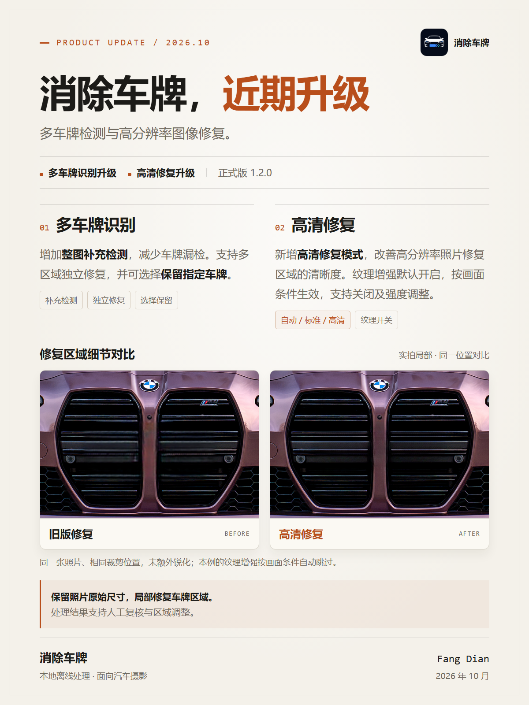
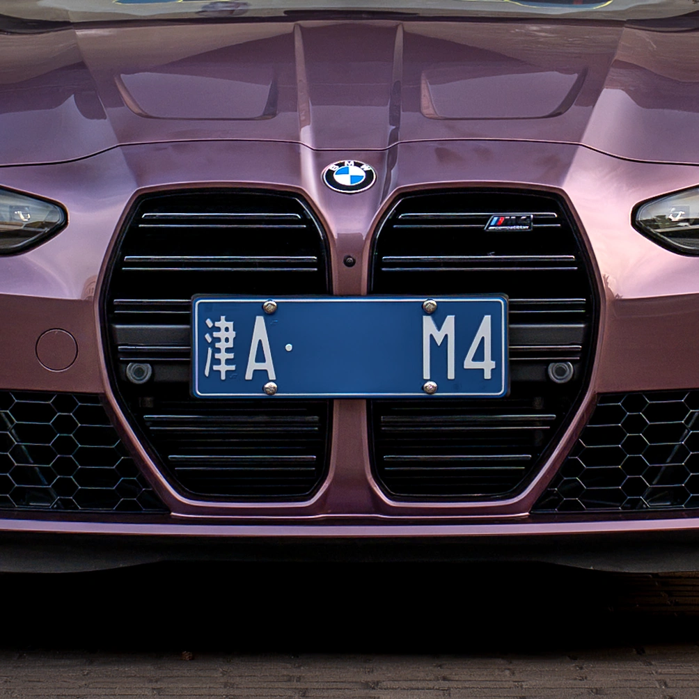
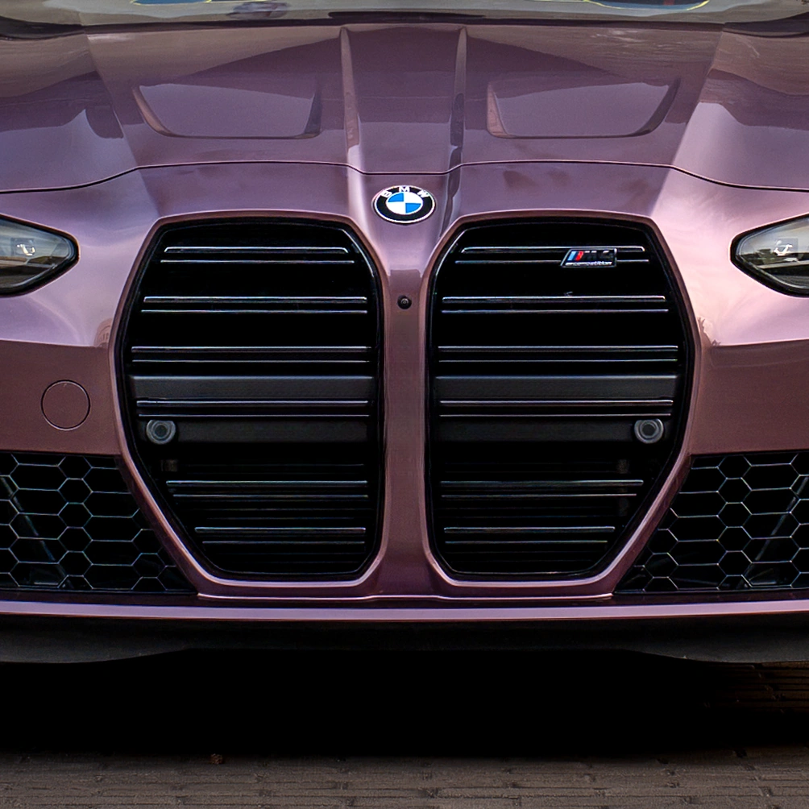
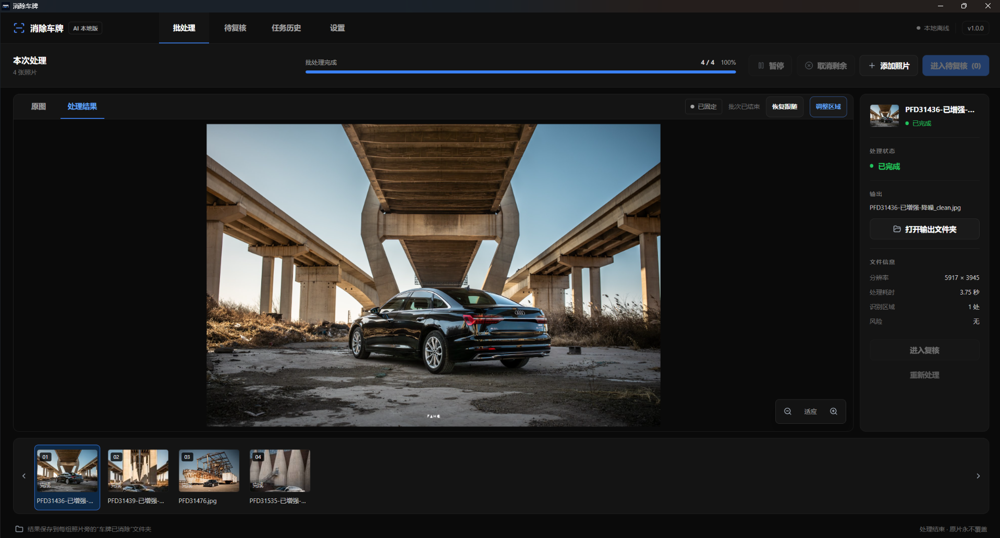

<p align="center">
  
</p>

<h1 align="center">消除车牌 · Remove Number Plate</h1>

<p align="center">让汽车照片，专注于车本身。</p>
<p align="center">离线批量处理 · 多车牌识别 · 高清修复 · 手动复核</p>
<p align="center"><strong>v1.2.0 正式版</strong> &nbsp; / &nbsp; Windows 10 / 11 · 64 位 &nbsp; / &nbsp; 非商用许可</p>

<p align="center">
  <a href="https://github.com/SARSfang/RemoveNumberPlate/releases/tag/v1.2.0"><strong>获取 Windows 版</strong></a> &nbsp; · &nbsp;
  <a href="https://fangdian.xyz/remove-number-plate/">产品介绍与交互对比</a> &nbsp; · &nbsp;
  <a href="docs/user-guide.md">使用指南</a> &nbsp; · &nbsp;
  <a href="https://github.com/SARSfang/RemoveNumberPlate/issues">反馈问题</a>
</p>

---

面向汽车摄影的本地车牌消除工具。拖入图片或文件夹，自动识别车辆与车牌，沿车牌透视轮廓生成遮罩，再使用 LaMa / Big-LaMa 修复对应区域。处理后的照片可以逐张复核，也可以手动调整车牌范围。

<p align="center">
  <a href="宣传素材/poster/近期升级_小红书3-4_HTML版.png">
    
  </a>
</p>

<p align="center">
  <a href="宣传素材/poster/近期升级_小红书3-4_HTML版.png">查看完整海报</a> ·
  <a href="宣传素材/poster/近期升级_小红书3-4_HTML版.html">可编辑 HTML 源文件</a>
</p>

## 下载与开始使用

1. 打开 [v1.2.0 正式版发布页](https://github.com/SARSfang/RemoveNumberPlate/releases/tag/v1.2.0)，下载安装程序 `RemoveNumberPlate-Setup-v1.2.0-win64.exe`。
2. 安装后启动“消除车牌”，拖入照片或文件夹，选择处理质量并开始处理。完整 CPU 发行包包含高清运行组件，无需自行安装 Python、CUDA 或 cuDNN。
3. 在预览中切换原图和处理结果；需要修改时进入“调整区域”，确认后保存。

支持 **JPEG、PNG、TIFF**。默认输出到源目录旁的 `车牌已消除` 文件夹，保留原始文件，并保留安全的 EXIF、ICC 与 DPI 元数据。照片处理在本机完成，无需上传图片。

**分享给别人：** 优先分享发布页或完整安装程序。若分享免安装版，应打包整个程序目录，保留 `_internal`、`hd-runtime` 等依赖，不能只发送 `消除车牌.exe`。分享时请保留版权声明、作者署名与许可全文，并遵守[非商用许可](LICENSE)。

## 近期升级

| 功能 | 带来的变化 |
| --- | --- |
| **多车牌识别** | 车辆区域检测结合整图补充检测，合并重复结果；多个车牌分别裁剪、独立修复，也可选择保留其中的车牌。 |
| **高清修复** | 新增 Big-LaMa 后端，改善高分辨率照片中填充区域明显变软的问题；支持自动、标准、高分辨率三种质量，输出照片尺寸保持不变。 |
| **可控纹理增强** | 默认开启，强度默认 25%；可用滑块开关关闭或调整强度，仅在邻近纹理适合时补充细节，强结构边缘或来源不合适时自动跳过。 |
| **更顺手的交互** | 新 Logo、滑块开关、分段质量选项；高清设置自动保存，预览支持适应窗口、1:1、缩放和平移。 |

自动模式会按局部修复尺寸选择后端，高清处理通常需要更多内存和时间，可在设置中调整处理上限。识别与修复效果受光照、反光、遮挡和背景结构影响；纹理增强不能恢复车牌遮挡的真实表面。更多说明见 [高清修复](docs/hd-repair.md)。

## 实拍消除前后

同一张实拍照片的相同区域，左侧为原图，右侧为高清修复结果。点击图片可查看展示文件，也可在[产品页](https://fangdian.xyz/remove-number-plate/)拖动滑块对比。

<table>
  <tr><th width="50%">消除前</th><th width="50%">高清修复后</th></tr>
  <tr>
    <td><a href="product-site/assets/original.webp"></a></td>
    <td><a href="product-site/assets/high.webp"></a></td>
  </tr>
</table>

展示图片为压缩后的网页预览，来自 `PFDA0512.jpg`；仅用于说明这张照片的处理结果，不代表所有场景。海报同时展示旧版与高清修复的局部对比。

## 批量处理，也能逐张精修

- **浏览整批照片：** 批处理页以单张大图为中心，底部胶片带快速切换；可自动跟随当前处理项，也可固定查看指定照片。
- **复核识别结果：** 低置信度照片集中进入待复核区，每张非处理中照片均可调整区域。
- **调整修复范围：** 四点透视框、新增或删除车牌框、画笔、橡皮擦、撤销和重做；边缘范围默认 35%，可在 −30% 至 +100% 间调整。
- **确认后再保存：** 编辑器临时结果写入本机缓存，确认保存后生成 `_clean_2`、`_clean_3` 等新文件，保留此前结果。

界面包含批处理、待复核、任务历史与设置四个分栏。桌面端使用系统 WebView2 与本地 HTML/CSS/JavaScript；检测和标准修复使用 ONNX Runtime，高清修复由独立 PyTorch 工作程序完成。100 张以上的胶片带采用窗口化渲染，1040×680 最小窗口和 200% 缩放下保留核心操作。

<details>
<summary>查看旧版界面示例（v1.0.0）</summary>

此图仅展示旧版布局；当前 v1.2.0 已更新 Logo、设置控件与高清处理选项。



</details>

## 文档与支持

| 我想了解… | 文档 |
| --- | --- |
| 如何使用与复核 | [用户指南](docs/user-guide.md) |
| 高清质量、纹理增强及运行组件 | [高清修复](docs/hd-repair.md) |
| 启动或处理失败 | [故障排除](docs/troubleshooting.md) |
| 本地处理与隐私 | [隐私说明](docs/privacy.md) |
| 技术方案与模型来源 | [项目技术介绍](项目技术介绍.md) · [模型说明](docs/models.md) |
| 发布与版本变化 | [版本说明](RELEASE.md) · [发布检查清单](docs/release-checklist.md) |

遇到问题可通过 [GitHub Issues](https://github.com/SARSfang/RemoveNumberPlate/issues) 反馈。在“设置 → 诊断与支持”中可导出 ZIP 诊断包，包含版本、运行环境、任务数量和轮转日志，不包含照片、文件路径或任务数据库。

## 开发与构建

<details>
<summary>开发环境、命令行处理与 Windows 打包</summary>

### 开发环境

已验证的开发环境为 Windows 10/11 与 Python 3.11。创建环境并安装依赖：

```powershell
python -m venv .venv
.\.venv\Scripts\python.exe -m pip install -r requirements-dev.txt
```

模型不提交到普通 Git 历史；来源、版本与 SHA-256 固定在 `models/manifest.json`。模型重建需要隔离的 Paddle 3.0 / Paddle2ONNX 2.1 环境，详细步骤见[模型说明](docs/models.md)。

```powershell
# 在模型转换环境中重建
python -m scripts.build_models

# 在开发环境中校验并启动
.\.venv\Scripts\python.exe -m scripts.verify_models
.\.venv\Scripts\python.exe run.py
```

高清后端使用独立 `.venv-hd` 环境与 `requirements-hd.txt`，不向标准环境加载 PyTorch。组件配置与构建步骤见[高清修复](docs/hd-repair.md)。CPU 路径已验证，GPU 路径尚未验收。

### 命令行批处理

```powershell
.\.venv\Scripts\python.exe -m app.cli process "D:\客户A\成片"
.\.venv\Scripts\python.exe -m app.cli resume
.\.venv\Scripts\python.exe -m app.cli report
```

### Windows 打包

日常开发测试：

```powershell
.\packaging\build_preview.ps1
.\启动测试版.cmd
```

固定测试版位于 `dist\preview`，重复构建后仍使用同一个启动入口。高清组件需另行构建，不能把标准测试包视为完整高清发行包。

候选版通过样片验收后构建安装程序：

```powershell
.\packaging\build_release.ps1
```

脚本会校验模型、运行检查、构建免安装目录与安装程序，并执行桌面启动验收。打包高清发行版前需按[高清修复文档](docs/hd-repair.md)准备运行组件。最终文件位于 `dist\installer`，同目录包含 SHA-256 校验值。

带 `v*` tag 的 GitHub 发布：配置代码签名 secrets（`WINDOWS_SIGN_CERTIFICATE_BASE64`）时构建签名版本，否则构建未签名版本并在日志中提示；Windows 首次运行可能显示未知发布者。

</details>

## 许可与版权

Copyright © 2026 Dian Fang（方典）。本项目采用**源码公开、非商用许可**，不是 OSI 认证的开源许可。完整条款以 [LICENSE](LICENSE) 为准。

- 允许查看、学习，以及个人和非商业用途的运行、复制与修改。
- 商业用途、闭源或专有形式的重新发布需要事先书面授权。
- 允许的复制、传播与修改须显著保留版权声明、作者署名及许可全文；不得移除或隐藏这些信息。

第三方组件受各自原始许可及 [THIRD_PARTY_NOTICES.md](THIRD_PARTY_NOTICES.md) 约束。商业授权或其他合作，请通过 [GitHub Issues](https://github.com/SARSfang/RemoveNumberPlate/issues) 联系作者。
